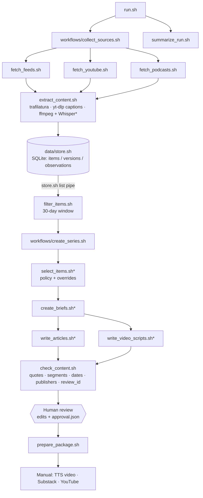

# Problem Set 4 Student Submission

**Student:** Iva Biscanic (Hubert H. Humphrey Fellow, MIT)  
**GitHub repository:** https://github.com/ivab2011/ps04-Ivas

## Topic and Audience

- **Publication name:** Agentic GRC (https://agenticgrc.substack.com)
- **Topic:** Governing agentic AI in critical infrastructure.
- **Audience and assumed knowledge:** Executives and risk, compliance and security leaders (CEO, COO, CFO, CISO),
  consultants and researchers working with critical-infrastructure operators in Europe and the US. They understand
  AI and their sector's regulation, but lack a clear view of where current frameworks fall short for AI systems that
  plan and act with some autonomy.
- **Central question:** As AI agents start acting autonomously in critical infrastructure, which risks are real,
  which claims are hype, and what do current governance frameworks require operators to do?
- **Scope and exclusions:** In scope: AI agents in critical-infrastructure operations (R1), rules and frameworks
  such as the EU AI Act, NIS2, NIST AI RMF and FERC/NERC CIP (R2), AI data centres as critical infrastructure (R3),
  and non-AI governance precedents usable only as labelled analogies (R4). Excluded: general geopolitics, defence
  and military dependencies, industrial-policy debates, consumer AI, product promotion. See
  [config/editorial_policy.md](config/editorial_policy.md).
- **Reason for readers to return:** Each edition tracks what changed in the last 30 days, separates verified
  facts from vendor and think-tank claims, and translates them into what operators should do next, with every
  claim traceable to a source passage.

## Published Series

| Piece | Title | Substack article | YouTube video |
| --- | --- | --- | --- |
| 1 | AI governance has moved from policy debate to control evidence | https://agenticgrc.substack.com/p/ai-governance-has-moved-from-policy | https://youtu.be/QC2pZxgDfdc |
| 2 | The real risk is not magic autonomy; it is unmanaged agency at scale | https://agenticgrc.substack.com/p/the-real-risk-is-not-magic-autonomy | https://youtu.be/_U7bKIOpa4M |
| 3 | What operators should do next: make AI governable before it becomes operationally normal | https://agenticgrc.substack.com/p/what-operators-should-do-next-make | https://youtu.be/uOHJDFtmSBo |

All three come from the approved run `runs/replay-20261018T205452Z` (evidence as of 2026-10-18). Each article
embeds its video; each video description links the article and lists every claim with its sources and timestamps.
Videos are narrated with AI text-to-speech in my own voice (Chatterbox), as allowed by the course update.

**Separate technical demonstration video:** https://youtu.be/TDscox2zpNA

## Setup and Execution

**Tools (macOS, Apple Silicon, via Homebrew):** git, jq, bash 5, python@3.12 (pipeline), python@3.11 (text-to-speech
only), ffmpeg/ffprobe, yt-dlp, git-filter-repo (used once to remove a personal file from history).

```bash
git clone https://github.com/ivab2011/ps04-Ivas && cd ps04-Ivas
python3.12 -m venv .venv && source .venv/bin/activate
pip install -r requirements.txt            # trafilatura, openai, markdown, ...
export OPENAI_API_KEY=...                  # only credential; never stored in the repo or logs
```

**Models and providers** ([config/models.json](config/models.json)): OpenAI `gpt-5.4-mini` for selection,
`gpt-5.5` for briefs, articles and video scripts, `whisper-1` for transcripts (only when YouTube captions are
unavailable, and for podcasts). Every rendered prompt and raw response is saved in `RUN_DIR/llm_calls/`.

**Configuration:** [config/project.json](config/project.json) (publication, topic, audience, central question),
[config/sources.json](config/sources.json) (source_id, publisher_id, kind, url; plus channel_id for YouTube),
[config/editorial_policy.md](config/editorial_policy.md), [config/editorial_overrides.json](config/editorial_overrides.json)
(human decisions applied after the model), and the prompts in [prompts/](prompts/). `run.sh` validates these and
snapshots them into each run.

**Commands**

```bash
bash run.sh                                            # new live run; stops at awaiting_review
bash run.sh --package runs/replay-20261018T205452Z     # re-check + package after human approval
bash run.sh --rerun-series runs/live-20261018T193123Z  # replay: series stages on stored evidence, current policy
SIMULATE_FAIL_SOURCE=atlanticcouncil bash run.sh       # labelled simulated collection failure
python docs/make_reports.py runs/replay-20261018T205452Z 02-c1   # regenerate docs/run_table.md and docs/claim_trace.md
```

Every component also runs on its own, e.g. `bash data/store.sh list | bash processing/filter_items.sh runs/ID`,
`bash editorial/select_items.sh runs/ID < runs/ID/eligible.jsonl`, `bash review/check_content.sh runs/ID`.

**Video production (manual handoff, own environment):**
```bash
/opt/homebrew/bin/python3.11 -m venv .venv-tts && source .venv-tts/bin/activate
pip install -r production/requirements-tts.txt          # chatterbox-tts, setuptools<81, pillow
bash production/make_videos.sh runs/replay-20261018T205452Z   # needs production/voice.wav (not in Git)
```

## Architecture and Manual Handoffs


`*` = model call (OpenAI). Only `data/store.sh` touches `data/evidence/`. Retained text and transcript segments
are in `data/assets/` (content-hash file names, never overwritten); raw media in `data/media/` (not in Git).

**Helpers** (each inside its component's responsibility): `collectors/collect.py` (shared RSS/Atom discovery),
`processing/extract.py`, `processing/filter_dates.py`, `data/store_db.py`, `editorial/selection.py`,
`editorial/briefs.py`, `content/generate.py` (incl. code-checked length revision), `review/check.py`,
`publishing/package.py`, `reporting/summary.py`, and `lib/` (receipts, model calls, evidence formatting,
reader-facing references built by code, review fingerprint).

**Manual handoffs**
1. **Editorial review:** read `RUN_DIR/articles/`, `video_scripts/`, `review.json`; edit drafts; rerun
   `review/check_content.sh`; write `approval.json` (review_id, decision, reviewer, notes, corrections).
2. **Package:** `bash run.sh --package RUN_DIR` → `package/` (articles, video scripts, source notes,
   manifest.json, publication_links.json, MANUAL_STEPS.md).
3. **Video:** `package/video_scripts/NN.md` → `production/make_videos.sh` (narration text → Chatterbox in my
   voice → title slide → mp4) → `production/out/video_NN.mp4`. Video 01 was sped up 1.15× with ffmpeg to stay
   near 5 minutes.
4. **Substack:** `production/to_html.py` renders `package/articles/NN.md` (with an AI-assistance note) for copying
   into a Substack Article; the YouTube video is embedded at the top.
5. **YouTube:** `production/yt_description.py` builds title + description (article link, AI-narration
   disclosure, all sources with timestamps) from `package/sources/NN.md`.
6. **Links:** recorded in `runs/replay-20261018T205452Z/package/publication_links.json`.

## Evidence and Runs

| Run | Actual date | Run artifacts and logs | Elapsed time | Approximate cost |
| --- | --- | --- | --- | --- |
| First live run | 2026-10-18 | [runs/live-20261018T193123Z](runs/live-20261018T193123Z) | see [run_table](docs/run_table.md) | Whisper: see run_table; model cost unknown |
| Second live run | 2026-10-19 | [runs/live-20261019T140450Z](runs/live-20261019T140450Z) | see [run_table](docs/run_table.md) | Whisper $0.87; model cost unknown |
| Simulated failure (labelled) | 2026-10-19 | [runs/live-20261019T143701Z](runs/live-20261019T143701Z) | see [run_table](docs/run_table.md) | Whisper $0; model cost unknown |
| Policy replays | 2026-10-18 | [replay-…203841Z](runs/replay-20261018T203841Z), [replay-…205452Z](runs/replay-20261018T205452Z) (published) | see [run_table](docs/run_table.md) | model cost unknown |

- **What changed between runs, duplicates, window checks, failure:** [docs/runs.md](docs/runs.md) and [docs/run_table.md](docs/run_table.md).
- **Costs:** Whisper cost is computed from audio minutes and is known. Model calls are logged with token counts
  (`llm_calls/`, receipts in `logs/`) but reported as unknown cost because no prices are configured.
- **Per run:** `candidates/`, `candidates.jsonl`, `items.jsonl`, `changes.jsonl`, `corpus.jsonl`, `eligible.jsonl`,
  `exclusions.jsonl`, `decisions.jsonl`, `briefs.jsonl`, `articles/`, `video_scripts/`, `review.json`, `summary.json`,
  `logs/` (one receipt per stage invocation), `llm_calls/`, `config/` and `prompts/` snapshots.
- **Evidence store:** `data/evidence/evidence.sqlite` (query only via `data/store.sh`); retained text and transcript
  segments in `data/assets/text/` and `data/assets/segments/`.
- **Media not in the repository:** podcast audio and Whisper inputs (`data/media/`) and the rendered videos
  (`production/out/`, published on YouTube). Audio can be re-downloaded from each item's `media_url` in
  `items.jsonl`, or with `yt-dlp <url>` for YouTube items. My voice sample is excluded for privacy.
- **Claim trace:** [docs/claim_trace.md](docs/claim_trace.md) follows claim 02-c1 from the published sentence to
  the brief, the editorial decision, the stored source version and the exact passage.

## Editorial Review

- **Policy and prompts:** [config/editorial_policy.md](config/editorial_policy.md) (v2, with change log; v1 is
  preserved in `runs/live-20261018T193123Z/config/editorial_policy.md`), [prompts/](prompts/), and the
  per-run snapshots.
- **Review of 3 accepted + 3 rejected/deferred items:** [docs/review_run1.md](docs/review_run1.md).
- **Policy revision and its effect** (decisions that changed, overrides, brief titles before and after):
  [docs/policy_revision.md](docs/policy_revision.md). Affected outputs: `decisions.jsonl` and `briefs.jsonl` in
  the two replay runs compared with run 1.
- **Human corrections:** 5 selection overrides (`config/editorial_overrides.json`; decision records keep the
  model's decision next to mine), the Dragos vendor video rejected, articles 01 and 02 trimmed by hand without
  removing claims (see the commit history of `runs/replay-20261018T205452Z/articles/`), and the approval record
  `runs/replay-20261018T205452Z/approval.json`.
- **Remaining limitations:** model costs not priced; articles about 915 words including title (approximate
  target); missing perspectives (operators' own voices, EU regulators such as ENISA, workers and communities);
  selection remains inconsistent between runs without human review.

## Reflection

**Insight.** Read together, FERC's audit findings (AI tools that mimic user behaviour and can create
lateral-movement paths), IBM's account of agent failure modes and AWS's grid-planning case all point in the same
direction: the governance gap for agentic AI is less a new risk category than a loss of evidence about *who or
what acted*. Humans stay accountable, but they need proof of what the agent did before the human decision point.
No single source says this; it emerges from connecting a regulator, a technology vendor and an operator use case.

**Editorial failure or limitation.** The selection model was not consistent. It rejected a Dragos vendor video in
one call and accepted it in the next with the same policy, stretched categories to fit non-AI items, and after
the policy revision ignored an explicit rule on military dependencies. A clearer policy fixed specific errors but
not consistency, so human overrides became part of the architecture.

**Next improvement.** Run selection twice (or with two models) and route every disagreement to human review
automatically; and add operator and EU-regulator sources (e.g. ENISA) to close the perspective gap.

**Architectural tradeoff.** Reader-facing references are built by code from the brief's evidence records, not
written by the model, and every quote is verified verbatim against the stored version before approval. This makes
the citation style more mechanical (claim markers plus a source list) but guarantees that no published reference
is invented or points to the wrong passage, which matters more for a governance audience than elegant footnotes.

**Engineering lessons.** A helper named `select.py` shadowed Python's `select` module; ffmpeg read the pipeline's
stdin and swallowed candidate records (fixed with `-nostdin`); a site rejected the default download client; and the
model altered IDs (fixed with unambiguous repair + retry). Each failure was visible because every stage writes a
receipt and saves its inputs and outputs.
